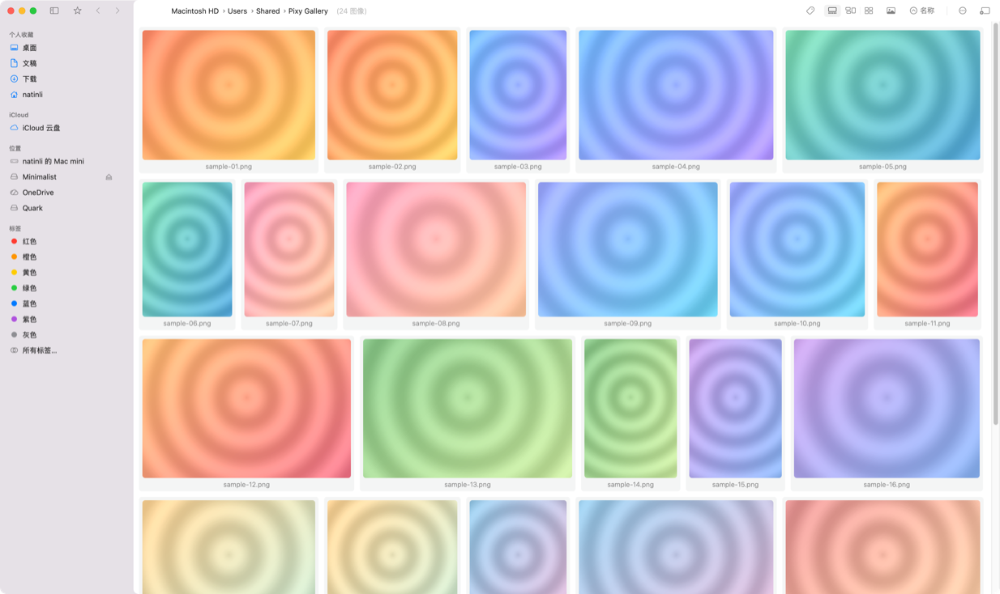
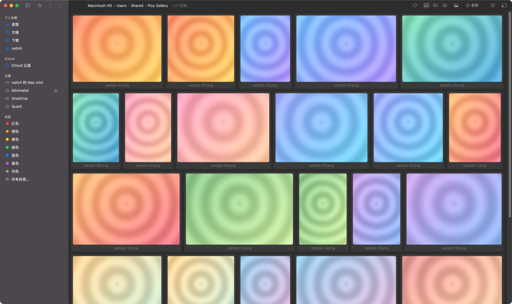

<p align="center">
<h1 align="center">Pixy</h1>
<h3 align="center">A fast, Finder-native image and video browser for macOS</h3>
</p>

<p align="center">
<a href="https://github.com/natinli/Pixy/releases"></a>


<a href="LICENSE"></a>
<a href="README_zh.md">简体中文</a>
</p>

Pixy is a macOS image and video browser that works the way Finder does: a real sidebar with your
places and tags, right-click gestures to move between image folders, and four thumbnail layouts that
stay smooth on directories with tens of thousands of files.

It is a secondary-development fork of [netdcy/FlowVision](https://github.com/netdcy/FlowVision).
Pixy keeps the upstream browsing engine and rebuilds the navigation shell around it — a Finder-style
sidebar, a two-part window layout with a shared material background, and a transparent title bar in
full-image view.

## Preview

### Light Mode


### Dark Mode


## Features

**Navigation**

- **Finder-style sidebar** — Desktop, Documents, Downloads, home, iCloud Drive, mounted volumes, OneDrive, and Finder tags, with disclosure, drag-and-drop, and per-window selection state
- **Right-click gestures** — drag right/left for the next/previous folder containing images, up for the parent, down to go back; an on-screen overlay shows the gesture as you drag
- **Multi-tab windows** — ⌘T to open, ⌘⇧T to restore, ⌘-click to open in the background
- **Breadcrumb path bar** — click any segment to jump; drop files onto a segment to move them
- **Recursive mode** — browse an entire subtree in one window

**Browsing**

- **Four layouts** — justified, waterfall, grid, and list, with per-style settings you can save and switch between
- **Large-image view** — high-quality downscaling, zoom to 100%, rotation and mirroring, EXIF/GPS panel, OCR and QR recognition
- **Transparent title bar** — in full-image view the content extends to the top of the window, with a small "filename · count" pill at the bottom
- **Video** — inline playback in thumbnails, continuous playback in list view, full transport controls with A-B loop
- **Formats** — HDR (macOS 14+), camera RAW, WebP, animated PNG

**Organization**

- **Finder tags and XMP ratings** — tag, rate, filter (AND/OR/NOT) and sort; ratings are written into XMP metadata without re-encoding
- **Enhanced index** — an optional local tag index that keeps large-directory filtering fast
- **Finder-equivalent file operations** — copy, cut, paste, rename (batch panel), delete, merge folders on conflict, drag out to other apps

**Performance**

- Incremental directory scanning and layout, LRU image caches with in-flight de-duplication, and priority re-ordering of thumbnail loads while you scroll

**Interface**

- Light and dark appearance, RTL layout, collapsible sidebar, portable-window mode, per-window stay-on-top

## Installation

Pixy requires **macOS 11.0 or later**. Releases are universal binaries for Apple Silicon and Intel.

### Homebrew

```sh
brew install --cask natinli/pixy/pixy
```

Upgrade with `brew upgrade --cask pixy`, remove completely (app, preferences, caches, search
index) with `brew uninstall --cask --zap pixy`. The tap lives at
[natinli/homebrew-pixy](https://github.com/natinli/homebrew-pixy).

### Manual download

Download the latest `.dmg` or `.zip` from [GitHub Releases](https://github.com/natinli/Pixy/releases),
then drag Pixy into Applications.

> ### ⚠️ Current builds are unsigned
>
> Pixy does not have a paid Apple Developer Program membership yet, so 0.x builds are **unsigned and
> not notarized** (ad-hoc signed only). macOS will block the first launch and you have to allow it
> once — this applies to the Homebrew install too, since Homebrew quarantines what it downloads:
>
> - **GUI:** try to open Pixy → "Done" → System Settings → Privacy & Security → **Open Anyway**.
> - **Terminal:** `xattr -dr com.apple.quarantine /Applications/Pixy.app`
>
> You have to repeat this for every new version you install. In this state Pixy is **not recommended
> as the default handler** for image files — macOS re-validates the signature periodically and
> double-clicking an image can stop working.
>
> Once a Developer ID certificate is available, releases will be signed and notarized and this
> workaround disappears. See [docs/dev/release.md](docs/dev/release.md).

Full first-launch guide: [docs/user/installation.md](docs/user/installation.md).

### Building from source

```bash
scripts/bootstrap-dependencies.sh --with-ffmpeg
xcodebuild -project FlowVision.xcodeproj -scheme FlowVision \
  -configuration Release -destination 'platform=macOS' \
  -onlyUsePackageVersionsFromResolvedFile \
  CODE_SIGNING_ALLOWED=NO CODE_SIGN_IDENTITY='' build
```

Requires Xcode 15.2+. Details in [docs/dev/build.md](docs/dev/build.md).

## Quick start

| Action | How |
|---|---|
| Open / close full-image view | Double-click a thumbnail |
| Zoom | Scroll in image view, or hold a mouse button and scroll |
| Navigate folders | Right-click gestures: right/left = next/previous image folder, up = parent, down = back |
| Navigate by keyboard | `W` parent, `A`/`D` previous/next, `S` back |
| Search and filter | ⌘F |

Full usage documentation: [docs/user/usage.md](docs/user/usage.md).
Troubleshooting: [docs/user/faq.md](docs/user/faq.md).

## Documentation

| Document | Description |
|---|---|
| [docs/index.md](docs/index.md) | Documentation hub, including a "find the doc for this task" table |
| [docs/user/](docs/user/installation.md) | Installation, usage, FAQ |
| [docs/dev/architecture.md](docs/dev/architecture.md) | Architecture, data flow, module map |
| [docs/dev/modules.md](docs/dev/modules.md) | Per-file responsibilities and key interfaces |
| [docs/dev/build.md](docs/dev/build.md) | Build, debug, common issues |
| [docs/dev/release.md](docs/dev/release.md) | Versioning, signing / unsigned release modes, CI secrets |
| [docs/dev/contributing-internal.md](docs/dev/contributing-internal.md) | Where to make changes, upstream merge strategy |
| [CHANGELOG.md](CHANGELOG.md) | Version history |

## Project layout

| Path | Contents |
|---|---|
| `FlowVision/Sources/` | Swift sources (AppKit). The Xcode scheme and folder keep the upstream name to ease merging |
| `FlowVision/Resources/` | Assets, storyboards, localization |
| `scripts/` | Dependency bootstrap, release packaging, repository hygiene checks |
| `docs/` | User and developer documentation |
| `.github/workflows/` | CI (build on push/PR) and release (on `v*` tags) |

Display name is **Pixy**; the Xcode project, scheme and bundle identifiers remain `FlowVision`-based
for upstream compatibility. See [CLAUDE.md](CLAUDE.md) for the AI-assistance entry point and
conventions.

## Contributing

Read [CONTRIBUTING.md](CONTRIBUTING.md), [SECURITY.md](SECURITY.md) and
[CODE_OF_CONDUCT.md](CODE_OF_CONDUCT.md) before opening a pull request or reporting a security issue.
Issues and pull requests are welcome.

## Acknowledgements

Pixy would not exist without [FlowVision](https://github.com/netdcy/FlowVision) by
[netdcy](https://github.com/netdcy), which provides the browsing engine, the layout algorithms and
the bulk of this codebase. Unless noted otherwise in `CHANGELOG.md`, features listed above come from
upstream.

Third-party dependencies and their licenses are listed in [THIRD_PARTY_NOTICES.md](THIRD_PARTY_NOTICES.md):
BTree, Settings, SDWebImage, libwebp, and FFmpegKit (full-gpl).

## License

GPL-3.0. See [LICENSE](LICENSE).
