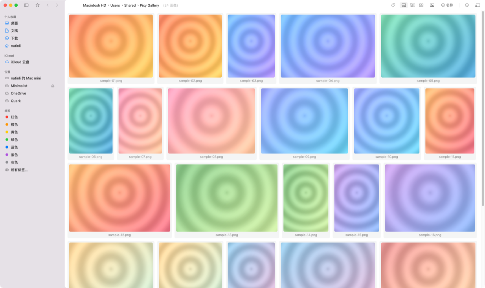
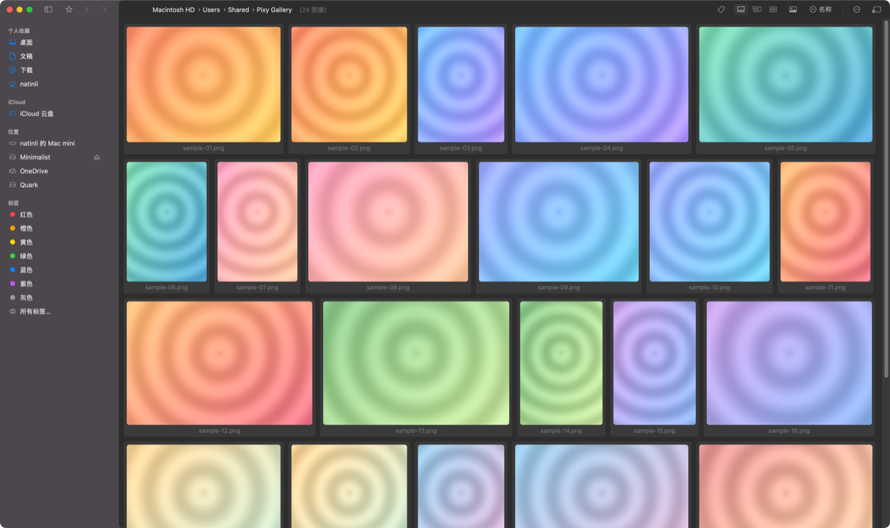

<p align="center">
<h1 align="center">Pixy</h1>
<h3 align="center">macOS 上原生 Finder 体验的图片与视频浏览器</h3>
</p>

<p align="center">
<a href="https://github.com/natinli/Pixy/releases"></a>


<a href="LICENSE"></a>
<a href="README.md">English</a>
</p>

Pixy 按 Finder 的方式浏览图片和视频：带真实目录树和标签的侧栏、用右键手势在图片文件夹之间跳转、
四种缩略图布局，并且在上万张图的目录里依然流畅。

Pixy 是 [netdcy/FlowVision](https://github.com/netdcy/FlowVision) 的二次开发分支。它保留上游的浏览内核，
重做外面这层导航外壳——Finder 风格侧栏、共享材质背景的两段式窗口布局、大图模式的透明标题栏。

## 界面预览

### 浅色


### 深色


## 功能

**导航**

- **Finder 风格侧栏** —— 桌面、文稿、下载、用户主目录、iCloud 云盘、挂载卷、OneDrive 与 Finder 标签；支持披露展开、拖放、按窗口独立的选中态
- **右键手势** —— 按住右键向右/左切到下一个/上一个含图片的文件夹，向上到父目录，向下返回历史；拖动过程有方向浮层提示
- **多标签页窗口** —— ⌘T 新建、⌘⇧T 恢复、⌘ 点击后台打开
- **面包屑路径条** —— 点任意段跳转；把文件拖到某一段等于移动到该目录
- **递归模式** —— 一个窗口浏览整个子树

**浏览**

- **四种布局** —— 自适应、瀑布流、网格、列表；每种风格可单独配置并保存切换
- **大图模式** —— 高质量缩放、100% 原始像素、旋转与镜像、EXIF/GPS 面板、OCR 与二维码识别
- **透明标题栏** —— 大图模式下内容延伸到窗口顶部，底部中央显示「文件名 · 张数」胶囊
- **视频** —— 缩略图内联播放、列表连续播放、完整控制条与 AB 循环
- **格式** —— HDR（macOS 14+）、相机 RAW、WebP、动态 PNG

**整理**

- **Finder 标签与 XMP 评级** —— 打标、评级、按标签过滤（与/或/反向）与排序；评级写入 XMP 元数据，不重新编码图像
- **增强索引** —— 可选的本地标签索引，让大目录的标签过滤保持快速
- **Finder 同源文件操作** —— 复制、剪切、粘贴、批量重命名、删除、文件夹冲突合并、拖到其他应用

**性能**

- 增量目录扫描与布局计算、带在途去重的 LRU 图片缓存、滚动时按可见中心距离重排缩略图加载队列

**界面**

- 浅色与深色外观、RTL 布局、侧栏收起、便携窗口模式、按窗口置顶

## 安装

Pixy 需要 **macOS 11.0 及以上版本**，发布包是 Apple Silicon 与 Intel 通用的二进制。

从 [GitHub Releases](https://github.com/natinli/Pixy/releases) 下载最新的 `.dmg` 或 `.zip`，把 Pixy 拖进「应用程序」。

> ### ⚠️ 当前版本没有签名
>
> Pixy 还没有付费 Apple Developer Program 账号，所以 0.x 版本**未签名、未公证**（只做了 ad-hoc 签名）。
> macOS 会拦截首次启动，需要手动放行一次：
>
> - **图形界面**：双击 Pixy 被拦截后点「完成」→ 打开「系统设置 → 隐私与安全性」→ 底部点「仍要打开」。
> - **终端**：`xattr -dr com.apple.quarantine /Applications/Pixy.app`
>
> **每个新版本下载后都要重新放行**。这个状态下 Pixy **不建议**设为图片格式的默认打开应用——
> macOS 会定期重新校验签名，双击图片可能突然打不开。
>
> 等具备 Developer ID 证书后，发布包会切换为签名 + 公证，这个放行步骤随之消失。详见
> [docs/dev/release.md](docs/dev/release.md)。

完整的首次启动说明见 [docs/user/installation.md](docs/user/installation.md)。

### 从源码编译

```bash
scripts/bootstrap-dependencies.sh --with-ffmpeg
xcodebuild -project FlowVision.xcodeproj -scheme FlowVision \
  -configuration Release -destination 'platform=macOS' \
  -onlyUsePackageVersionsFromResolvedFile \
  CODE_SIGNING_ALLOWED=NO CODE_SIGN_IDENTITY='' build
```

需要 Xcode 15.2+，细节见 [docs/dev/build.md](docs/dev/build.md)。

## 快速上手

| 操作 | 方式 |
|---|---|
| 打开 / 关闭大图 | 双击缩略图 |
| 缩放 | 大图中滚轮，或按住鼠标键滚动 |
| 文件夹导航 | 右键手势：右/左 = 下一个/上一个图片文件夹，上 = 父目录，下 = 返回 |
| 键盘导航 | `W` 父目录，`A`/`D` 上一个/下一个，`S` 返回 |
| 搜索与过滤 | ⌘F |

完整用法见 [docs/user/usage.md](docs/user/usage.md)，问题排查见 [docs/user/faq.md](docs/user/faq.md)。

## 文档

| 文档 | 内容 |
|---|---|
| [docs/index.md](docs/index.md) | 文档总入口，含「按任务找文档」对照表 |
| [docs/user/](docs/user/installation.md) | 安装、使用、常见问题 |
| [docs/dev/architecture.md](docs/dev/architecture.md) | 架构、数据流、模块地图 |
| [docs/dev/modules.md](docs/dev/modules.md) | 逐文件职责与关键接口 |
| [docs/dev/build.md](docs/dev/build.md) | 构建、调试、常见构建问题 |
| [docs/dev/release.md](docs/dev/release.md) | 版本号规则、签名/未签名两种发布模式、CI 凭据 |
| [docs/dev/contributing-internal.md](docs/dev/contributing-internal.md) | 改动落点、上游合并策略 |
| [CHANGELOG.md](CHANGELOG.md) | 版本历史 |

## 目录结构

| 路径 | 内容 |
|---|---|
| `FlowVision/Sources/` | Swift 源码（AppKit）。工程与 scheme 保留上游名称，便于合并 |
| `FlowVision/Resources/` | 资源、storyboard、本地化 |
| `scripts/` | 依赖准备、发布打包、仓库卫生检查 |
| `docs/` | 用户向与开发向文档 |
| `.github/workflows/` | CI（push/PR 构建）与 Release（`v*` tag 触发） |

展示名是 **Pixy**，而 Xcode 工程、scheme 和 bundle id 仍保留 `FlowVision` 命名以便与上游保持一致。
AI 协作入口与约定见 [CLAUDE.md](CLAUDE.md)。

## 参与贡献

提交 PR 或报告安全问题前，请先读 [CONTRIBUTING.md](CONTRIBUTING.md)、[SECURITY.md](SECURITY.md) 和
[CODE_OF_CONDUCT.md](CODE_OF_CONDUCT.md)。欢迎 issue 与 pull request。

## 致谢

Pixy 建立在 [netdcy](https://github.com/netdcy) 的 [FlowVision](https://github.com/netdcy/FlowVision) 之上：
浏览内核、布局算法和这个代码库的大部分内容都来自上游。除非 `CHANGELOG.md` 另有说明，上面列出的功能均来自上游。

第三方依赖与许可证见 [THIRD_PARTY_NOTICES.md](THIRD_PARTY_NOTICES.md)：BTree、Settings、SDWebImage、libwebp、FFmpegKit（full-gpl）。

## 许可证

GPL-3.0，见 [LICENSE](LICENSE)。
